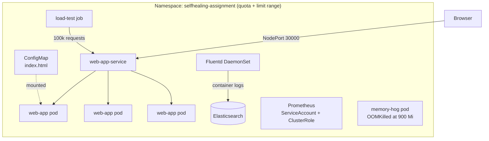

# Kubernetes Self-Healing Lab


A self-healing web app on a local Kubernetes cluster: health probes restart broken
pods, a rolling update keeps the app online during changes, resource quotas and limits
stop one workload from starving the rest, and stress tests prove it all works.
Logs go to Elasticsearch through Fluentd, and Prometheus collects metrics.

Built as a course assignment (August 2025), running on a [kind](https://kind.sigs.k8s.io/) cluster.

## At a glance

- **Self-healing:** startup, liveness and readiness probes on a 3-replica nginx app
- **Zero-downtime updates:** rolling update with `maxSurge: 1` and `maxUnavailable: 1`
- **Guardrails:** a namespace `ResourceQuota` plus a `LimitRange` that sets default, minimum and maximum CPU and memory for every container
- **Failure testing:** a memory-hog pod that gets OOM-killed, a stress deployment, and a load-test job with 100,000 requests
- **Packaging:** a Helm chart for the web app
- **Observability:** Prometheus with RBAC, plus Fluentd → Elasticsearch for logs

## Architecture



## What each file does

| Area | File | What it does |
| --- | --- | --- |
| Cluster | `kind-config.yaml` | Local kind cluster with ports 30000–30002 and 30080 mapped to the host |
| Guardrails | `namespace.yaml` | Creates the `selfhealing-assignment` namespace |
| | `resource-quota.yaml` | Caps the namespace at 2 CPU / 4 Gi requested, 4 CPU / 8 Gi limits, 20 pods |
| | `limit-range.yaml` | Default 100m CPU / 128 Mi per container, max 500m / 1 Gi |
| Web app | `web-app-configmap.yaml` | The HTML page, mounted into nginx |
| | `web-app-deployment.yaml` | 3 replicas, rolling update, startup, liveness and readiness probes, CPU and memory limits |
| | `web-app-service.yaml` | NodePort service on 30000 and an internal ClusterIP service |
| Helm | `web-app-chart/`, `values.yaml` | Helm chart for the web app, with custom values for replicas, image, NodePort 30001 and probes |
| Failure tests | `resource-test-deployment.yaml` | 2 pods running `stress` with 100 MB memory each, inside their limits |
| | `web-app-chart/memory-hog-pod.yaml` | Asks for 1500 MB with a 900 Mi limit, so Kubernetes OOM-kills it |
| | `web-app-chart/load-test-job.yaml` | `hey` load test: 100,000 requests, 50 at a time |
| Monitoring | `web-app-chart/prometheus-*.yaml` | Prometheus deployment, config, service, and RBAC to discover pods |
| Logging | `web-app-chart/elasticsearch-*.yaml`, `fluentd-daemonset.yaml` | Single-node Elasticsearch and a Fluentd agent on every node shipping container logs to it |

## How the self-healing works

| Probe | Setting | What it protects against |
| --- | --- | --- |
| **Startup** | 10 tries, every 5 s | Gives the container up to 50 s to start before other probes begin |
| **Liveness** | after 30 s, every 15 s, 3 failures | A hung container is restarted automatically |
| **Readiness** | after 5 s, every 5 s, 3 failures | A pod that isn't ready gets no traffic until it recovers |

## Run it

Needs Docker, [kind](https://kind.sigs.k8s.io/), `kubectl` and Helm.

```bash
# 1. Cluster and guardrails
kind create cluster --config kind-config.yaml
kubectl apply -f namespace.yaml -f resource-quota.yaml -f limit-range.yaml

# 2. Web app
kubectl apply -f web-app-configmap.yaml -f web-app-deployment.yaml -f web-app-service.yaml
kubectl get pods -n selfhealing-assignment
# open http://localhost:30000

# 3. Monitoring and logging
kubectl apply -f web-app-chart/prometheus-rbac.yaml -f web-app-chart/prometheus-config.yaml \
              -f web-app-chart/prometheus-deployment.yaml -f web-app-chart/prometheus-service.yaml
kubectl apply -f web-app-chart/elasticsearch-deployment.yaml -f web-app-chart/elasticsearch-service.yaml \
              -f web-app-chart/fluentd-daemonset.yaml

# 4. Helm version of the app
helm install web-app-helm ./web-app-chart -f values.yaml -n selfhealing-assignment
```

## Prove it heals

```bash
# Delete one pod: the Deployment replaces it
kubectl delete -n selfhealing-assignment \
  $(kubectl get pods -n selfhealing-assignment -l app=web-app -o name | head -1)
kubectl get pods -n selfhealing-assignment -w

# Memory hog: watch Kubernetes OOM-kill it
kubectl apply -f web-app-chart/memory-hog-pod.yaml
kubectl get pod memory-hog -n selfhealing-assignment -w      # STATUS: OOMKilled

# Stress pods that stay inside their limits
kubectl apply -f resource-test-deployment.yaml

# Quota usage
kubectl describe resourcequota namespace-quota -n selfhealing-assignment
```

Elasticsearch runs with security turned off and a demo password, for local testing only.

## What I'd improve now

Looking back at this assignment, these are the changes I'd make next:

- **Helm templates:** the chart is the default Helm scaffold, so it doesn't yet read the probe, rolling-update and NodePort settings in `values.yaml`. The templates need updating to use them.
- **Load test target:** `load-test-job.yaml` points at `web-app-helm-web-app-chart-service`, but the chart names the service `web-app-helm-web-app-chart`.
- **Autoscaling:** `hpa.yaml` uses `autoscaling/v2beta1`, which newer Kubernetes versions removed. It should move to `autoscaling/v2`.
- **Metrics:** Prometheus only scrapes pods with `prometheus.io/scrape` annotations, so the web app needs those annotations (and an exporter) to show up.
- **Logs UI:** add Kibana so the logs in Elasticsearch can be searched in a browser.

## Skills demonstrated

Kubernetes (Deployments, Services, ConfigMaps, DaemonSets, Jobs, RBAC) · health probes ·
rolling updates · ResourceQuota and LimitRange · Helm · kind · Prometheus ·
Elasticsearch and Fluentd (EFK) · load and failure testing

## Author

**Dinesh Chette** · Cloud & DevOps Engineer · [GitHub](https://github.com/Dineshchette1) · [LinkedIn](https://www.linkedin.com/in/dineshchette)
